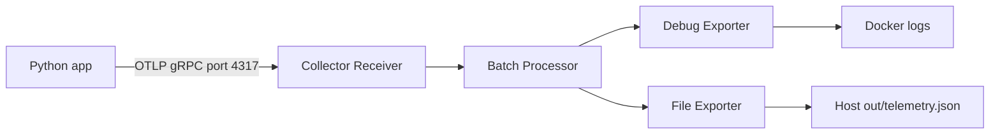

# A8 OpenTelemetry — Task 1 + Task 2 (Level E)

Target grade: **E**. Task 3/O is outside scope.

## Task 1: SDK + Console
1. Python 3.10+; `python -m pip install -r requirements.txt`
2. `python demo.py --mode console`
3. Observe parent `checkout` and child `charge-card`. Both share a trace ID; child's `parent_id` equals parent `span_id`.
4. Screenshot terminal output and explain trace and exporter.

## Task 2: Docker Collector + OTLP
Use Docker Desktop/Engine and create a writable `out` directory.

Linux/macOS:
```bash
mkdir -p out && chmod 777 out
docker run --name a8-otel-collector --rm -p 4317:4317 \
  -v "$(pwd)/otel-collector-config.yaml:/etc/otelcol/config.yaml:ro" \
  -v "$(pwd)/out:/out" \
  otel/opentelemetry-collector:0.164.0
```

Windows PowerShell (create `out` folder first):
```powershell
New-Item -ItemType Directory -Force out
docker run --name a8-otel-collector --rm -p 4317:4317 `
  -v "${PWD}/otel-collector-config.yaml:/etc/otelcol/config.yaml:ro" `
  -v "${PWD}/out:/out" `
  otel/opentelemetry-collector:0.164.0
```

Second terminal:
```bash
python demo.py --mode otlp
docker ps
docker logs a8-otel-collector
```

Check `out/telemetry.json` for trace content. Save authentic screenshots for Docker running, Collector logs, and local output.

## Pipeline / 流程


## Concepts / 概念
- Trace: request-level record composed of related spans (同一次請求的完整追蹤).
- Span: one operation/timed segment; child links to parent (一個操作區段).
- Exporter: sends telemetry to a destination (輸出遙測資料).
- Receiver: listens for and receives OTLP gRPC telemetry (接收).
- Processor: batches telemetry before export (批次處理).
- Debug/File exporters: print to Collector logs and write to a mounted local file (本機輸出).

**Status:** Task 1 console execution was verified separately. Task 2 requires real Docker execution and screenshots before claiming E grade. Submit a 6–12 page PDF as `A8_YourName_Opentelemetry.pdf`.
